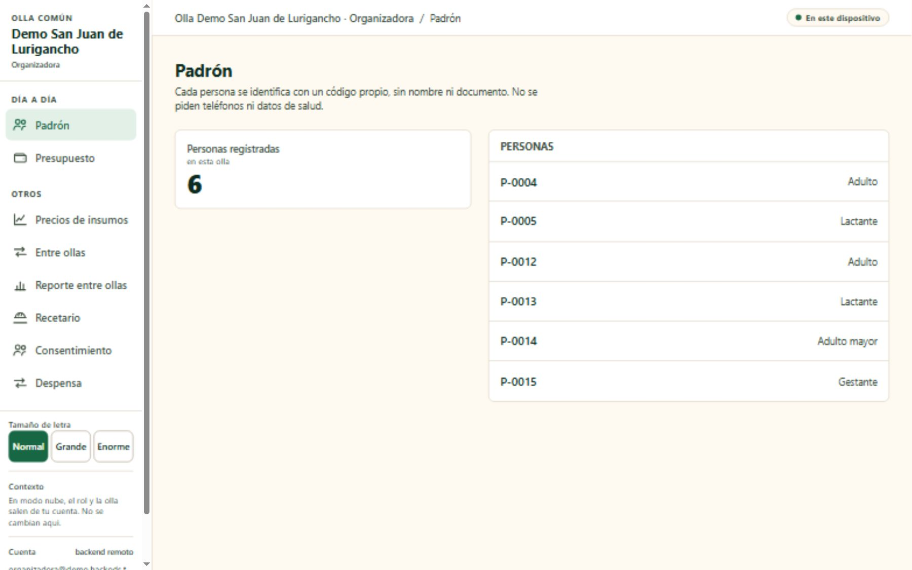
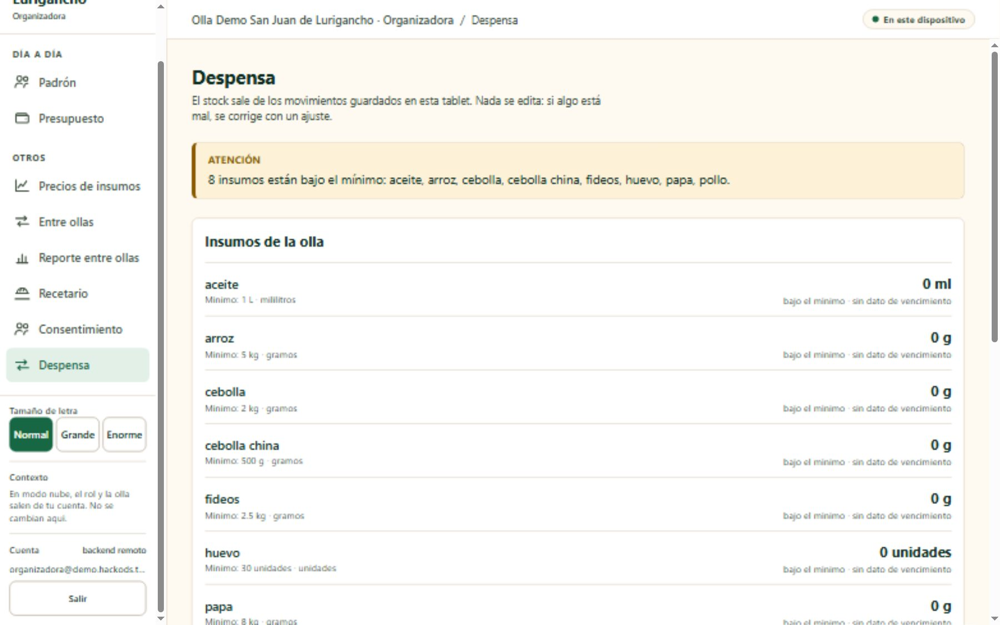
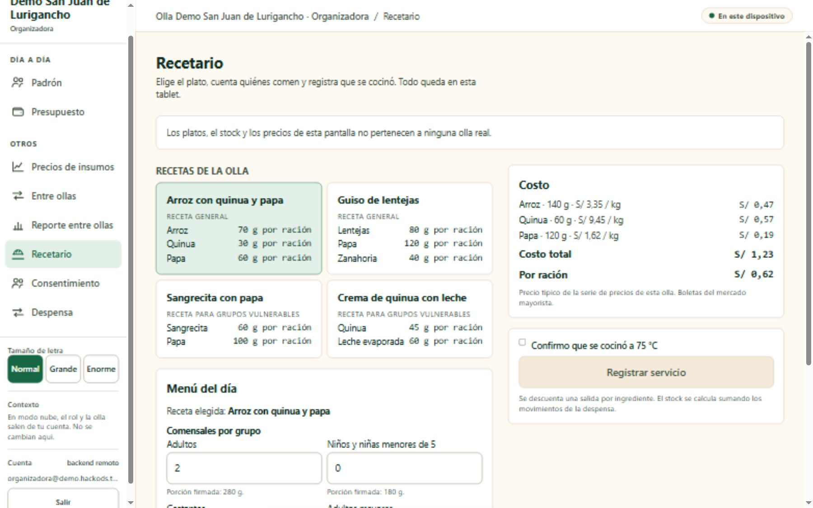

# hackODS-Autonoma-2026

Una aplicación para ollas comunes y comedores del Perú que ayuda a saber **a quién alimenta**, **qué va
a cocinar** y **cuánto le queda**. Está pensada para funcionar sin internet, en un celular compartido y
con personas que no tienen por qué saber usar una computadora.

La olla registra a sus personas, publica un menú aprobado por una nutricionista, anota lo que entra y
sale de la despensa, guarda sus boletas y ve cuánto puede gastar. Cuando vuelve la señal, todo se pone
al día sin perder ni duplicar lo que se anotó sin red.

## Capturas

| Padrón | Despensa | Recetario |
|---|---|---|
|  |  |  |

Tomadas del demo con sesión real contra Supabase: la olla, el rol y las filas salen de RLS, no de un
fixture.

## Para quién

Para organizadoras, cocineras y nutricionistas de ollas comunes y comedores PCA. El contexto manda:
baja alfabetización digital, un solo celular por olla y una red que se corta.

## Qué hace

1. **Padrón por código.** Cada persona es `P-0001`. El nombre, si se usa, queda solo en el celular.
2. **Despensa compartida.** Stock derivado de movimientos (nunca un saldo editable), lotes con
   vencimiento y aviso de mínimo; una olla puede **pedir o enviar** lo que le falta o le sobra.
3. **Captura por voz, foto o texto.** El dictado graba con el micrófono, la boleta entra por foto y el
   texto se pega; siempre se muestra lo entendido antes de confirmar.
4. **Menú semanal firmado.** Lo aprueba una nutricionista con su colegiatura y una huella verificable;
   el sistema ajusta la porción según el grupo de edad o condición.
5. **Recetario con costo.** Al marcar «se cocinó» se descuentan los ingredientes y se ve el costo por
   ración; si falta un precio, dice `sin dato`.
6. **Comprobantes.** Una foto de la boleta se convierte en ítems que una persona revisa y confirma
   antes de que cuenten.
7. **Presupuesto.** Cuánto se asignó, cuánto se gastó, cuánto está comprometido y cuánto queda.
8. **Precios por zona.** Las compras de todas las ollas alimentan la serie por distrito para elegir
   dónde comprar.
9. **Solicitud entre ollas.** Una olla pide insumos a otra y sigue el estado del pedido, con roles y
   consentimiento para el seguimiento.
10. **Offline de verdad.** Se trabaja sin red y se sincroniza al recuperar señal; nunca se pisa lo
    anotado ni se duplica.
11. **Reporte agregado.** Cada olla ve su detalle; las demás ven solo totales (k≥10), sin nombres de
    personas ni de proveedores.

## Qué NO hace

- No diagnostica ni detecta enfermedades.
- No prescribe dietas ni calcula requerimientos individuales.
- No reemplaza el criterio de la nutricionista.
- No guarda la identidad de las personas en la nube: allí solo existe el código `P-XXXX`.
- No hace contabilidad, facturación ni trámites con la municipalidad.

## Documentación

- [Decisiones que mandan](docs/DECISIONES.md)
- [Cómo se coordina el equipo](docs/PROTOCOL.md)
- [Contratos de comprobantes](docs/contracts/comprobantes.md)
- [Segundo backend de cómputo](docs/ARQUITECTURA-COMPUTE.md)
- [Mapa de fuentes por tema](docs/FUENTES.md)
