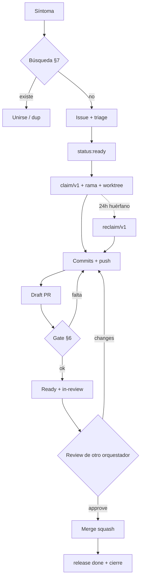

<!--
META (no copiar):
- Secciones 0 a 11  -> docs/PROTOCOL.md
- Anexo A -> .github/ISSUE_TEMPLATE/tarea.yml
- Anexo B -> .github/PULL_REQUEST_TEMPLATE.md
- Anexo C -> scripts/labels.sh (ejecutar una vez por repo)
- Anexo D -> scripts/claim.sh
- Anexo E -> .github/CODEOWNERS
- Anexo F -> docs/adr/0000-plantilla.md
- Anexo G -> .github/workflows/claim-stale.yml (opcional)
Verificado contra gh 2.101.0 y docs de GitHub (issue forms, CODEOWNERS, search syntax).
-->

# Protocolo de coordinación — 3 orquestadores, N subagentes, un repo

**Versión 1.0 · dueño: el equipo · cambios por PR a este archivo (requiere 2 aprobaciones).**

---

## 0. El contrato, en 12 líneas

1. El **issue** es la unidad de trabajo. Sin issue, no hay trabajo; sin evidencia, no hay issue.
2. El **chat es rumor**. Si no está en GitHub, no pasó.
3. Antes de empezar: **buscar** issues, PRs, ramas y commits. Siempre.
4. **Reclamar** con una línea `claim/v1`. Un issue, un claim vigente, una rama, un worktree, un agente.
5. **Draft PR en el primer push**, no al final.
6. Solo el **orquestador** abre y mergea PRs. Los subagentes commitean y pushean a *su* rama.
7. **Nadie mergea lo suyo sin aprobación de otro orquestador** (otra cuenta, otro humano).
8. "Resuelto" = PR mergeado + prueba que fallaba antes y pasa después + salida pegada.
9. Área = dueño. Archivo compartido = contrato de interfaz primero, código después.
10. Claim sin push ni heartbeat en 24 h = **huérfano**: se reclama con aviso, no se adivina.
11. Decisión que cruza áreas = **ADR** de 10 líneas, mergeado antes del código que la usa.
12. Bloqueado 30 min = comentario. Bloqueado 2 h = humano. Irreversible = humano **ya**.

---

## 1. Fuente de verdad

### 1.1 Tres capas, un solo dueño cada una

| Capa | Vive en | Es verdad sobre | Se edita con |
|---|---|---|---|
| **Código y decisiones** | `main` del repo | qué hace el sistema, por qué | PR mergeado |
| **Trabajo y evidencia** | Issues + PRs (+ Project como vista) | qué falta, quién lo tiene, qué se probó | comentarios, labels, PRs |
| **Conversación** | OpenChamber / chat | nada | nada; se transcribe o se pierde |

**Regla dura:** una afirmación solo es verdad si tiene un objeto de GitHub que la respalde. El chat sirve para pedir, avisar y desbloquear; nunca para dejar estado.

### 1.2 Verdad vs rumor

| Afirmación | ¿Verdad? | Qué la hace verdad |
|---|---|---|
| "Esto está roto" | No todavía | Issue abierto con **reproducción** (comando + salida + commit/versión) |
| "Lo estoy arreglando" | No todavía | `claim/v1` vigente + rama remota + assignee |
| "Ya está resuelto" | No | PR **mergeado** a `main` + test rojo→verde + salida pegada en `## Prueba` |
| "Lo revisé" | No | `review/v1` con `sha:` del commit revisado y `verdict:` |
| "Nadie lo está haciendo" | No | búsqueda del §7 ejecutada hoy, y ningún claim vigente |
| "Decidimos X" | No | ADR mergeado, o comentario en el issue que nombra el ADR |
| "El CI está roto por otra cosa" | Solo con link | URL del run + issue aparte que lo cubre |

### 1.3 Por qué Issues + Project (v2) y no un tablero en el chat

- **Los issues son direccionables.** `#142` es una referencia estable que sobrevive a la compactación de contexto, al reinicio de una sesión y al cambio de agente. Un mensaje de chat no.
- **El historial es el log de la operación.** Cada claim, heartbeat, review y merge queda con autor y timestamp, sin que nadie lo escriba a mano. Eso es auditoría gratis.
- **Los agentes ya saben hablarlo.** `gh issue view/edit/comment`, `gh pr create/review/merge`, `gh api`: todo es CLI, sin integraciones nuevas ni permisos raros.
- **Cierra el círculo con el código.** `Closes #142` en el PR conecta trabajo, diff, CI y cierre. Es el único lugar donde "qué se hizo" y "por qué" quedan pegados.
- **El Project (v2) no es la verdad: es la vista.** Un tablero con vistas filtradas por label. Sirve para que un humano mire en 5 segundos qué hay en curso. Si el tablero y el issue discrepan, gana el issue, siempre.

**Por qué el estado canónico son labels y no el campo Status del Project:** los labels se leen y escriben con un comando (`gh issue edit -l`), se filtran en search, sobreviven a la API y no necesitan el scope `project`. El campo Status necesita resolver `project-id` + `item-id` + `field-id` en cada escritura: tres llamadas más por claim, y un punto de drift más. Entonces:

> **Labels `status:*` = estado canónico y mutuamente excluyente. Project = vistas filtradas por esos labels.** Nadie edita Status a mano. (Los workflows integrados "item cerrado → Done" y "PR mergeado → Done" siguen siendo útiles y no molestan.)

### 1.4 Un issue = una unidad mergeable

Un issue debe poder cerrarse con **un** PR (o un stack de 3 como máximo). Si no podés escribir el criterio de aceptación en una línea, no es un issue: es un épico, y los épicos no se reclaman. Se parten en sub-issues (`gh issue create --parent <n>`) o en `blocked-by`.

---

## 2. Identidad: quién escribe

### 2.1 Una cuenta de GitHub por persona, agentes con nombre de sesión

**Requisito técnico, no preferencia:** GitHub no permite aprobar tu propio PR. Si los tres orquestadores comparten una cuenta, la revisión cruzada del §6 es imposible y el protocolo se cae. Entonces:

- Una cuenta por humano (`@ana`, `@beto`, `@caro`), cada una con `write` en el repo.
- Los agentes **usan la cuenta de su humano** y se identifican con un token de sesión:
  - `ana-lead-<4hex>` → orquestador de Ana.
  - `ana-sub-<rol>-<4hex>` → subagente de Ana (`ana-sub-api-91c0`).
  - El token va en el claim, en el trailer del commit y en el `review/v1`. Es lo que permite reconstruir *qué sesión* hizo qué dentro de una misma cuenta.
- Cada commit lleva trailer: `Agent: ana-sub-api-91c0`. Se ve en el log y en el PR.

**Trade-off aceptado:** no hay atribución por agente en la UI de GitHub, pero la hay en el claim y en el commit, que es donde se audita. A cambio, CODEOWNERS y reviews funcionan con personas reales.

### 2.2 Quién puede qué

| Acción | Subagente | Orquestador | Humano |
|---|---|---|---|
| Crear issue | sí (con plantilla) | sí | sí |
| Reclamar issue | no | sí | sí |
| Crear rama / worktree | no | sí | sí |
| Commit + push a **su** rama | sí | sí | sí |
| Abrir PR / marcar ready | no | sí | sí |
| Aprobar PR de otro | no | sí | sí |
| Mergear a `main` | **nunca** | sí, tras aprobación | sí |
| Cambiar labels de estado | no | sí | sí |
| Mergear `main` a su rama | **nunca** (rebase) | nunca | nunca |
| `push --force` | no | solo `--force-with-lease` en su rama | — |

Se implementa con tres capas: convención (este doc), un wrapper que rechaza verbos prohibidos (`scripts/claim.sh` + alias de `gh`), y **branch protection** (la única que no se puede olvidar). Si un subagente intenta `gh pr merge`, la protección igual lo frena porque `main` exige aprobación de otro.

### 2.3 Ajustes de repo obligatorios (una vez)

- `main` protegida: sin force, 1 aprobación como mínimo, `dismiss_stale_reviews`, checks requeridos,
  conversaciones resueltas.
- **`Require review from Code Owners`** apagado mientras haya una sola cuenta
  (`require_code_owner_reviews: false`, `enforce_admins: false`). Estado real y condición para
  activarlo: `docs/ORQUESTACION.md` §8.
- "Allow auto-merge" solo cuando exista una segunda cuenta que pueda aprobar; antes no aporta.
- Actions con permiso de escritura solo donde haga falta (el workflow de §G necesita `issues: write`).

---

## 3. Reclamo de tareas (claim)

### 3.1 Precondiciones (las tres, o no se reclama)

1. **Búsqueda del §7 ejecutada** y su resultado pegado en el claim (`searched:<fecha>`).
2. El issue tiene label `status:ready`: criterio de aceptación + reproducción + prueba esperada ya escritos. Un issue en `status:triage` **no se reclama**: se acota primero (15 min máx).
3. El issue no tiene otro `claim/v1` vigente.

### 3.2 Gramática del claim

Una sola línea, todo en minúsculas, `clave:valor`, separada por un espacio, sin espacios dentro de los valores, timestamps UTC RFC 3339. Después de una línea en blanco, lo que quieras en humano (el parser ignora todo lo que no empiece con el verbo).

```
claim/v1 issue:142 by:@ana agent:ana-lead-3f2a area:api branch:feat/api-142-oauth-refresh started:2026-11-23T14:02Z ttl:24h searched:2026-11-23 files:apps/web/src/sync/**
```

| Campo | Regla |
|---|---|
| `issue` | número, sin `#` |
| `by` | handle con `@`, cuenta real con write |
| `agent` | `<humano>-<rol>-<4hex>` |
| `area` | una de `web`, `api`, `infra`, `contracts` (la misma que el label `area:*`) |
| `branch` | nombre completo, ya empujado al remoto |
| `started` | `YYYY-MM-DDTHH:MM:SSZ` |
| `ttl` | `24h` por defecto; `72h` para spikes |
| `searched` | fecha de la búsqueda anti-duplicado |
| `files` | globs separados por coma, **solo archivos calientes** (ver §5.3). Opcional pero obligatorio si tocás algo de `contracts/` |

Máximo 300 caracteres. Si no entra, el alcance es demasiado grande: partí el issue.

### 3.3 Secuencia exacta (copiar y pegar)

```bash
# 0) preflight
gh issue view 142 --comments
gh label create status:claimed --force --color 1D76DB --description "Claim vigente" >/dev/null

# 1) rama + worktree, atada al issue (queda linkeada en la UI del issue)
gh issue develop 142 --base main --name feat/api-142-oauth-refresh \
  --worktree ../wt/142-oauth-refresh --checkout

# 2) claim + estado + assignee, en una sola pasada
gh issue comment 142 --body "claim/v1 issue:142 by:@ana agent:ana-lead-3f2a area:api branch:feat/api-142-oauth-refresh started:$(date -u +%Y-%m-%dT%H:%M:%SZ) ttl:24h searched:$(date -u +%F) files:apps/web/src/sync/**

Reclamo #142. Worktree: ../wt/142-oauth-refresh. Draft PR en el primer push."
gh issue edit 142 --add-label status:claimed --remove-label status:ready --add-assignee @me

# 3) primer push y draft PR (dentro de los primeros 30 min de trabajo real)
git commit --allow-empty -m "wip: arranco #142

Agent: ana-lead-3f2a"
git push -u origin feat/api-142-oauth-refresh
gh pr create --draft --base main --title "feat(api): refresh de OAuth (#142)" \
  --body-file .github/PULL_REQUEST_TEMPLATE.md --label area:api --assignee @me
```

`gh issue develop --worktree` crea la rama en el remoto, la deja linkeada al issue (visible como "linked branches") y la checkoutea en el worktree indicado. Es el único paso que hace falta para que "quién trabaja en esto" sea visible sin bookkeeping extra.

### 3.4 Heartbeat

Trabajo largo (> 4 h) sin push: una línea cada sync, editando *el mismo* comentario de claim o agregando uno nuevo (el último gana).

```
heartbeat/v1 issue:142 agent:ana-lead-3f2a at:2026-11-23T20:10Z head:9c1e4ab state:coding
```

`state:` ∈ `coding | review | blocked | waiting`. `head:` es el SHA corto actual. Un heartbeat cuenta como actividad (es la señal de "sigo vivo"), pero **3 heartbeats seguidos con el mismo `head:`** marcan el claim como atascado (`needs:human`) sin liberarlo automáticamente.

### 3.5 Expiración y reclamo de huérfanos

- **Actividad** = push a la rama, o un `heartbeat/v1` más nuevo que el último push, o un `release/reclaim` del propio dueño. Nada más: un like, una mención o un mensaje de chat no cuentan.
- Un claim con `ttl:24h` y **0 actividad en 24 h** está **huérfano**: deja de ser exclusivo, pero no se cierra nada automáticamente.
- **Regla de los 12 h de aviso:** para reclamar un huérfano, primero se publica el `reclaim/v1` con `notice:12h` y se menciona al dueño. Si en 12 h el dueño publica un heartbeat válido, el reclaim queda **anulado** (la prioridad es de quien ya tenía el claim). Si no aparece, el nuevo dueño empieza.
- **Excepción:** si el último push tiene más de 72 h y no hay PR, `notice:0h` y se reclama directo. Se avisa igual.
- Un claim **nunca** se hereda por silencio de un agente: siempre hay una línea `reclaim/v1` con evidencia. Si dos reclaman a la vez, gana el timestamp más viejo del `notice` y el otro espera; si es el mismo minuto, decide el humano del área.

```
reclaim/v1 issue:142 by:@caro agent:caro-lead-77c1 from:@ana agent:ana-lead-3f2a last_activity:2026-11-22T09:14Z evidence:9c1e4ab at:2026-11-24T11:00Z notice:12h
```

Acción mecánica del reclaim: comentario + `gh issue edit 142 --add-assignee @caro`, y la rama vieja **no se borra ni se reescribe**: se sigue desde el último commit con `git rebase main` en un worktree nuevo, o se empieza de cero y se cierra el PR viejo con `dup:`/`superseded:`.

### 3.6 Liberar (release)

```
release/v1 issue:142 by:@ana agent:ana-lead-3f2a reason:done at:2026-11-23T18:40Z pr:187 next:none
```

`reason:` ∈

| reason | cuándo | qué más se hace |
|---|---|---|
| `done` | PR mergeado | issue se cerró con `Closes #142` |
| `handoff` | lo sigue otro agente/persona | `next:@quien`; el nuevo dueño **no** re-reclama, hereda con un `claim/v1` que dice `inherits:142` |
| `abandoned` | no se sigue | comentario con qué quedó hecho y por qué; branch se borra a los 7 días |
| `superseded` | lo reemplaza otro issue | link al nuevo |
| `duplicate` | ya existe otro issue | link al original |

Acción mecánica: `gh issue edit 142 --remove-label status:claimed --remove-label status:in-review` y, si no se cierra, devolver a `status:ready` (para `abandoned`/`handoff`) o cerrar como `not planned` con link (para `duplicate`/`superseded`).

### 3.7 Tabla de estados (labels canónicos)

| Label | Significa | Quién lo pone | Transición permitida |
|---|---|---|---|
| `status:triage` | hay un síntoma, falta acotarlo | cualquiera | → `status:ready` o cierre |
| `status:ready` | acotado, con criterio y prueba esperada | orquestador dueño del área | → `status:claimed` |
| `status:claimed` | hay claim vigente | quien reclama | → `status:in-review`, `status:blocked`, `status:ready` (release) |
| `status:in-review` | PR no-draft esperando revisión cruzada | autor | → `status:claimed` (cambios pedidos) o cierre |
| `status:blocked` | espera otro issue o decisión | dueño | → `status:claimed` cuando se destraba |

Regla: **un solo `status:*` por issue en todo momento.** El script de §D los quita todos menos el nuevo; si ves dos, es un bug del script, no una licencia.

---

## 4. Ramas y worktrees

### 4.1 Modelo: trunk-based, ramas de horas

- `main` siempre verde y deployable. Nada de `develop`, `staging`, `release/*` mientras el equipo sea 3.
- Rama por issue, vida útil objetivo **< 48 h**, máximo 5 días.
- `main` se mueve rápido: **rebase**, no merge, para actualizar la rama. El merge a `main` es **squash**.
- Prohibido `git merge main` dentro de la rama: ensucia el diff y el squash pierde sentido. Prohibido merge commits en `main`.

| Estrategia | Decisión | Por qué |
|---|---|---|
| Actualizar rama | `git rebase origin/main` | diff limpio, un commit por PR al mergear |
| Integrar a main | squash (`gh pr merge --squash --delete-branch`) | un commit = un issue = `git revert` trivial |
| Merge queue | activar si hay > 2 merges/hora | evita el "main rojo" por carreras |
| Force push | solo `--force-with-lease`, solo en rama propia | nunca sobre la rama de otro |

### 4.2 Nombres

```
feat/<area>-<issue#>-<slug>      feat/api-142-oauth-refresh
fix/<area>-<issue#>-<slug>       fix/web-203-login-loop
chore/<area>-<issue#>-<slug>     chore/infra-210-pin-node
docs/<issue#>-<slug>             docs-231-adr-queue
spike/<area>-<slug>              spike/api-240-vector-search   (timebox 1 día, no se mergea)
```

`<area>` ∈ `web|api|infra|contracts`. `<slug>` en kebab-case, ≤ 4 palabras, sin acentos. El número de issue en la rama es lo que permite encontrar el trabajo desde `git branch -r` en 2 segundos.

### 4.3 Un worktree por agente

```bash
# el orquestador prepara; el subagente solo entra
git worktree add ../wt/142-oauth-refresh -b feat/api-142-oauth-refresh origin/main
# o, mejor, con el link al issue:
gh issue develop 142 --base main --name feat/api-142-oauth-refresh --worktree ../wt/142-oauth-refresh --checkout
```

Convención de ruta: `../wt/<issue#>-<slug>` (hermano del repo, nunca dentro). Un worktree = una rama = un agente. Dos agentes en el mismo worktree es el bug más caro y más difícil de diagnosticar: `git status` miente, los índices se pisan, aparecen archivos borrados que nadie borró. **Nunca.**

Limpieza, cuando el PR cerró:

```bash
git worktree remove ../wt/142-oauth-refresh
git branch -d feat/api-142-oauth-refresh
git fetch --prune
```

### 4.4 Draft PR temprano

- Se abre **en el primer push**, aunque sea un commit vacío con `wip:`. Costo: 20 segundos. Beneficio: número de PR visible, CI corriendo, y nadie más empieza lo mismo.
- Mientras es draft: nadie está obligado a revisarlo, y CODEOWNERS **no** manda review requests (los drafts no disparan la notificación). Eso es bueno: el momento de pedir revisión es cuando el gate del §6 está completo.
- **Un issue = un PR.** Si necesitás dos PRs, son dos issues (o un stack declarado: `base` del hijo = rama del padre, y el padre se mergea primero).

### 4.5 Tamaño máximo

| Métrica | Límite | Si lo superás |
|---|---|---|
| Líneas cambiadas | 400 (sin lockfiles ni generados) | partí el issue o stack de 2 |
| Archivos | 10 | partí por área |
| Vida de la rama | 48 h (blando), 5 días (duro) | el issue estaba mal acotado: re-acotar |
| Commits en el PR | ilimitado (se squashea) | — |

Un PR de 1.500 líneas no se revisa: se aprueba por cansancio. Ese es el modo de falla más común de los equipos con agentes, porque el agente no se cansa de escribir.

### 4.6 Quién hace qué en git

| Paso | Subagente | Orquestador |
|---|---|---|
| Crear rama/worktree | no | sí (`gh issue develop`) |
| Commit | sí, con trailer `Agent:` | sí |
| Push a la rama de la tarea | sí | sí |
| Rebase sobre `main` | sí (su rama) | sí |
| Abrir / editar el PR | no | sí |
| Marcar ready / pedir review | no | sí |
| Correr el gate y pegar evidencia | sí (ejecuta) | sí (pega y firma) |
| Aprobar review de otro | no | sí |
| Merge | **no** | sí, tras aprobación ajena |
| Cerrar issue / limpiar rama | no | sí |

Rationale: el subagente tiene el contexto del código pero no el del equipo. Las acciones que cambian el estado compartido (PR, labels, merge) las hace quien ve el tablero. Es una separación por información disponible, no por jerarquía.

---

## 5. Propiedad por área

### 5.1 Reparto de 3 personas

| Persona | Área (`area:*`) | Carpetas (ejemplo) | También revisa |
|---|---|---|---|
| A | `web` | `apps/web/`, `packages/ui/`, `packages/printing/` | `api`, `contracts` |
| B | `api` | `supabase/` | `web`, `contracts` |
| C | `contracts` + `infra` | `packages/{contracts,domain,nutrition,sync}/`, `docs/`, `scripts/`, `.github/` | `web`, `api` |

Ajustá las rutas a tu repo; lo que **no** se negocia es: **una carpeta tiene un solo dueño**. El dueño
no es el único que puede escribir: es el único que puede aprobar y el que decide ante conflicto.
`packages/contracts/` es la excepción: lo mantiene C, pero todo PR ahí necesita **2 aprobaciones**
(una de A, una de B).

### 5.2 `contracts/` (área compartida) = contrato primero

Todo lo que dos áreas consumen (tipos de API, esquemas de eventos, interfaces de módulos compartidos) vive en `packages/contracts/` con su propio dueño colectivo. Regla:

1. El cambio de contrato va en **su propio PR**, chico, solo `packages/contracts/**`.
2. Ese PR necesita 2 aprobaciones (una de cada área consumidora, idealmente las dos).
3. Se mergea **antes** que los PRs que lo usan. Los consumidores trabajan contra el contrato ya mergeado (o contra un stub que respeta la firma).
4. Cambio incompatible: nueva versión (`v2`) en paralelo, no edición in-place. Se borra la vieja cuando nadie la importa.

Sin esto, "compartido" significa "de nadie" y en 3 días hay dos versiones del tipo `User` y un bug que nadie puede reproducir.

### 5.3 Cuando dos necesitan el mismo archivo

Orden de resolución, de menos a más caro:

1. **Declararlo en el claim** (`files:apps/web/src/sync/**`). Si el glob del otro se solapa, se ve antes de escribir la primera línea.
2. **Ganar por claim más viejo** para ese archivo. El segundo no edita; consume.
3. **Shim de interfaz**: el segundo agrega una función/adaptador en *su* archivo y no toca el ajeno. 80% de los casos se resuelve así.
4. **Esperar**: el segundo se pone `status:blocked` con `blocked-by` del issue del primero. Costo real: horas, no días.
5. **Escalar**: si el archivo es caliente (router central, `package.json`, `schema.prisma`, config de CI), el dueño del área hace el cambio por los dos, o se parte el archivo en el mismo sprint. Se anota como deuda con issue.

**Prohibido:** editar el archivo caliente "un poquito" mientras el otro tiene el claim. Eso es exactamente el conflicto que este protocolo existe para evitar, y es el que más se repite porque el agente no siente el costo.

### 5.4 Límites reales de CODEOWNERS (no inventar features)

- El archivo va en `.github/CODEOWNERS`, `CODEOWNERS` o `docs/CODEOWNERS` (se usa el primero que exista) y **debe estar en la rama base** del PR para tener efecto.
- Los owners necesitan **write** en el repo; los equipos deben ser visibles y tener write.
- Gana la **última** línea que matchea. No hay negación (`!`) ni rangos de caracteres.
- Los **draft PRs no disparan** review requests de code owners; al marcar ready, sí.
- Con "Require review from Code Owners", **alcanza la aprobación de un owner** de la línea, no de todos. Si necesitás que dos áreas aprueben sí o sí, subí a 2 approvals y que ninguna sea del área autora.
- No impide pushes directos por sí solo: eso lo hace la branch protection.

---

## 6. Verificación: el gate

### 6.1 Nada se dice resuelto sin esto

El gate se completa **en el PR**, en la sección `## Prueba` (Anexo B). Si falta un campo, el PR no está listo y no se pide review.

| # | Requisito | Cómo se comprueba |
|---|---|---|
| 1 | Bug **reproducido** antes del fix | comando + salida pegada (o video de 10 s) |
| 2 | Prueba que **falla antes y pasa después** | nombre del test + salida roja + salida verde |
| 3 | CI verde en el último commit | `gh pr checks <n> --required` |
| 4 | Solo archivos del alcance | `gh pr diff <n> --name-only` vs `files:` del claim |
| 5 | Criterios de aceptación del issue, uno por uno | checklist con evidencia por ítem |
| 6 | Sin secretos ni `.env` | el comando de abajo, sin resultados |
| 7 | Rebase sobre `main` hecho | `git log --oneline origin/main..HEAD` sin merges |
| 8 | Docs/ADR actualizados si cambió comportamiento | link en el PR |

```bash
git diff origin/main...HEAD | rg -i '(api[_-]?key|secret|token|passw|BEGIN [A-Z ]*PRIVATE)'
```

### 6.2 Quién valida

- **Revisor = otro orquestador**, nunca el autor, nunca un subagente del autor. Con 3 personas: round-robin por área (Ana revisa api, Beto revisa infra, Caro revisa web; `contracts/` lo revisan las dos áreas consumidoras).
- El revisor **no confía en el texto**: checkoutea y corre.

```bash
gh pr checkout 187            # en su propio worktree, no en el del autor
git log --oneline -5
<comando del gate que el autor puso en ## Prueba>
gh pr checks 187 --required
```

- El veredicto es una línea machine-readable, además del review nativo:

```
review/v1 pr:187 by:@beto agent:beto-lead-11ab verdict:approve sha:4f2a9c1 gate:pass at:2026-11-23T19:22Z
```

o `verdict:changes` con el motivo en la línea siguiente. El `sha:` es obligatorio: una aprobación vale para ese commit. Si el autor pushea después, la aprobación **no** vale (por eso `dismiss_stale_reviews`).

- **Nadie mergea su propio review** y **el revisor no mergea**: mergea el orquestador autor, con la aprobación ajena ya puesta. Así el que mergea es el que responde por el cambio.

```bash
gh pr merge 187 --squash --delete-branch   # solo si reviewDecision=APPROVED y checks verdes
```

- Si el autor y el revisor no se ponen de acuerdo en 2 rondas: se escala (§8.5). No se "arregla" con `--admin` nunca.

### 6.3 Anti-patrones explícitos

| Frase | Veredicto |
|---|---|
| "Debería funcionar" | no es evidencia |
| "Los tests pasan" (sin salida) | no es evidencia |
| "Lo probé en local" | vale solo con comando + salida |
| "Es un cambio trivial, lo mergeo" | el gate no tiene excepción por tamaño |
| "El CI falla por algo ajeno" | link al run + issue que lo cubre; si no, es tuyo |
| "Ya lo arreglé, confiá" | el revisor corre el comando |

---

## 7. Duplicados: "¿alguien ya lo está haciendo?"

### 7.1 Búsqueda obligatoria (60 segundos, antes de crear o reclamar)

```bash
# 1. issues abiertos y cerrados, por síntoma y por área
gh issue list --state all --search "oauth refresh in:title,body" --limit 20
gh issue list --state all --label area:api --limit 30

# 2. PRs abiertos y mergeados (incluye drafts)
gh pr list --state all --search "oauth refresh" --limit 20
gh pr list --state open --limit 50

# 3. ramas remotas (el trabajo puede existir sin issue)
git fetch --prune && git branch -r --sort=-committerdate | head -30

# 4. commits recientes que mencionen el síntoma o el área
git log --since=21.days --oneline --grep="oauth" -i
git log --since=21.days --oneline -- apps/web/src/sync/

# 5. claims vigentes en comentarios
gh issue list --state open --search "claim in:comments" --limit 50
```

`in:comments` es un qualifier real de la búsqueda de issues: sirve para encontrar claims aunque el título no diga nada. Es la consulta que más falsos negativos evita.

**Corrección (probada en `03-verificacion-antiduplicados.md`):** `"claim/v1 in:comments"` **no** matchea la cadena literal. GitHub indexa `claim/v1` como dos tokens (`claim` + `v1`) y devuelve falsos positivos. Buscá `claim` (amplio) y dejá que el parser de `scripts/preflight.ps1` decida: el veredicto sale del parser, nunca del buscador.

### 7.2 Huella (fingerprint) del problema

Sin labels dinámicos (explotan en 200 labels inútiles). La huella va en el **título** y en el **cuerpo**, y se busca por texto:

```
[api] refresh de OAuth devuelve 401 tras 30 min (fp:api-oauth-refresh-401)
```

- Prefijo `[area]` → filtrable y legible.
- `(fp:<area>-<2-3 palabras>-<síntoma>)` → el token exacto que se busca. Mismo problema, mismo `fp:`.
- El buscador humano y el agente buscan `fp:api-oauth-refresh-401`; si aparece, es el mismo.

### 7.3 Qué hacer según el resultado

| Situación | Acción |
|---|---|
| Issue idéntico, `status:ready`, sin claim | reclamar ese, no crear otro |
| Issue idéntico con claim vigente | **no reclames**: comentá `interested/v1` y ofrecé ayuda; o tomá otra tarea |
| Issue idéntico cerrado como `not planned` | reabrir con evidencia nueva (`gh issue reopen`), no crear otro |
| Issue parecido pero alcance distinto | crear nuevo con `blocked-by`/`related` y link cruzado |
| PR abierto que ya lo hace | sumate como reviewer; no abras otro |
| Rama remota sin issue | comentar en la rama/PR o abrir issue que la adopte; nunca borrarla |

### 7.4 Duplicado descubierto a mitad de trabajo

Regla: **parar de pushear primero, decidir después.** No se sigue "porque ya casi está".

1. Comentario en tu issue:
   ```
   dup/v1 issue:142 of:137 by:@ana agent:ana-lead-3f2a at:2026-11-23T16:05Z action:join
   ```
   `action:` ∈ `close` (el otro gana), `merge-scope` (partir: uno hace A, otro B), `join` (te sumás al otro PR).
2. `release/v1 ... reason:duplicate` y devolvé el label a `status:ready` o cerrá.
3. Si tenés código útil: lo pegás como **comentario en el PR/issue ganador** (diff o `git format-patch`), no abrís otro PR. Después de 48 h sin que nadie lo tome, se borra la rama.
4. Si el otro issue estaba cerrado y el bug volvió: **no** es duplicado, es regresión. Issue nuevo, `type:bug`, link al cierre anterior, y el test de regresión es obligatorio.

El sesgo por defecto es **unirse**, no competir: dos PRs para lo mismo cuestan más que un día perdido, porque además hay que elegir cuál gana con el código ya escrito.

---

## 8. Comunicación entre orquestadores

### 8.1 Canales, por tipo de mensaje

| Qué | Dónde | Por qué ahí |
|---|---|---|
| Estado de una tarea | comentario en **su issue** | queda pegado a la evidencia |
| Discusión de código | **review del PR** (línea o general) | queda en el diff |
| Estado del equipo, bloqueos, "voy a tocar X" | issue **`coordination`** (fijado, uno solo) | un lugar para leer el pulso |
| Decisión que afecta a otro | **ADR** en `docs/adr/` | versionada, citable |
| Ping urgente | chat + **transcripción al issue en < 5 min** | el chat no deja rastro |
| Handoff entre turnos | comentario `handoff/v1` en el issue | el próximo agente lo lee primero |

Un solo issue `coordination`, fijado, con label `coordination`. Nunca dos. Si necesitás un tema nuevo, es un issue normal con `needs:decision`.

### 8.2 Cadencia

- **Async-first.** Dos syncs por día, al empezar y al terminar el turno: 5 líneas en `coordination`, no una reunión.
- Formato del sync (una línea por cosa, sin prosa):

```
sync/2026-11-23T14:00Z @ana agent:ana-lead-3f2a
doing: #142 (in-review), #150 (claimed)
next: revisar #187 de @beto
blocked: #151 espera decisión de contrato (needs:decision)
risk: main se movió 14 commits, rebase pendiente en 3 ramas
```

- Si hay un humano presente y hace falta: 15 min de llamada, y **lo que se decidió se pega en el issue antes de cortar**. Si no quedó escrito, no se decidió.

### 8.3 Handoff (cambio de agente o de turno)

```
handoff/v1 issue:142 from:@ana agent:ana-lead-3f2a to:@ana agent:ana-lead-9d21 at:2026-11-23T22:40Z sha:4f2a9c1 state:in-review

Qué está hecho: endpoint + tests, falta el caso de token revocado (test rojo en auth.spec.ts:88).
Qué NO tocar: apps/web/src/sync/legacy.ts (lo tiene @beto en #155).
Siguiente paso: arreglar el test, pushear, marcar ready y pedir review a @caro.
Riesgos: el mock de reloj asume UTC; no cambiar TZ.
```

Regla: un handoff **siempre** dice qué NO tocar. Es el campo que evita el 90% de los accidentes entre turnos.

### 8.4 Escalado

| Situación | Plazo | Acción |
|---|---|---|
| Bloqueado por otro issue/PR | 30 min | comentario con `blocked-by` + @mención al dueño |
| Sin respuesta | 2 h | escalar a humano (`needs:human`), seguir con otra tarea (no esperar idle) |
| Dos claims sobre el mismo archivo | inmediato | dueño del área decide; si es `contracts/`, ADR + humano |
| Decisión irreversible (borrar datos, cambiar auth, migración, force push a main) | **antes** | humano, sí o sí, con el plan escrito en el issue |
| Revisor y autor no coinciden en 2 rondas | 2 h | tercer orquestador desempata; si sigue, humano |
| CI roto en `main` | inmediato | el que lo rompió lo arregla o revierte; si no aparece en 30 min, cualquiera revierte (`git revert`) con issue |

**Revertir no es castigar:** es restaurar el servicio. Se revierte y se discute después, en el issue.

### 8.5 Decisiones: ADR de 10 líneas

Un ADR es obligatorio si la decisión: (a) toca una interfaz entre áreas, (b) cambia una dependencia o infraestructura, (c) elige entre dos opciones con costo de revertir, (d) alguien podría preguntar "¿por qué está así?" en 3 semanas.

Formato: Anexo F. Se mergea **antes** del código que depende de él. Se referencia desde el issue (`ADR: docs/adr/0007-...md`). No se editan ADRs viejos: se supersede con uno nuevo.

---

## 9. Reglas anti-caos (las 10 duras)

1. **No tocar archivos fuera del área sin aviso.** Aviso = comentario en el issue + `files:` en el claim. Sin aviso, el PR se rechaza aunque el código esté bien.
2. **No reescribir la rama de otro.** Ni `push --force`, ni rebase, ni "limpieza de commits". La rama ajena es de solo lectura.
3. **No mergear sin gate.** Ni con `--admin`, ni "es urgente", ni "son dos líneas". El gate no tiene excepciones por tamaño.
4. **No abrir dos PRs para lo mismo.** Si aparece otro, se cierra con `dup:` y link.
5. **No arreglar el CI ajeno sin reclamo.** Si el fallo es de otro issue, comentá y esperá; si es de `main` y está roto > 30 min, revertí con issue.
6. **No crear un issue sin búsqueda previa.** El `searched:` del claim es la prueba de que buscaste.
7. **No reclamar dos tareas a la vez.** Un claim activo por agente. (Un orquestador puede tener 1 en `in-review` + 1 en `claimed`; nunca dos en `claimed`.)
8. **No dejar trabajo sin push > 4 h.** Commit local sin push no existe para el equipo. Heartbeat o push.
9. **No inventar estado en el chat.** Si lo dijiste ahí y no está en el issue, para el equipo no pasó.
10. **No editar `main` directamente, ni el `PROTOCOL.md`, ni `CODEOWNERS`, sin PR + 2 aprobaciones.** Las reglas también se revisan.

Consecuencia (para que no sea decorativo): 1ª vez, comentario y corrección. 2ª vez en la misma semana, el orquestador pierde el merge de esa tarea (lo mergea otro). 3ª, revisión del protocolo con el humano.

---

## 10. Flujo completo

```
0. SÍNTOMA — chat, log, bug report, idea
│
├─ 1. BÚSQUEDA §7 — issues (abiertos y cerrados), PRs, ramas remotas, commits, claims
│     ├─ existe y está libre   ──sí──> reclamar ese issue                (→ 3)
│     └─ existe y está tomado  ──sí──> unirse, comentar o tomar otra tarea (fin)
│
├─ 2. ISSUE (plantilla A) — reproducción + criterio de aceptación + prueba esperada
│     └─ status:triage ──> status:ready     (sin esto no se puede reclamar)
│
├─ 3. CLAIM §3 — claim/v1 + assignee + status:claimed
│     └─ gh issue develop --worktree ──> rama + worktree (§4)
│
├─ 4. TRABAJO — el subagente commitea y pushea a su rama
│     └─ > 4 h sin push ──> heartbeat/v1 en cada sync
│
├─ 5. DRAFT PR — en el primer push. Un issue = un PR.
│
├─ 6. GATE §6 — «## Prueba» completo + CI verde + rebase sobre main
│     └─ marcar READY ──> status:in-review ──> pedir review a otro orquestador
│
├─ 7. REVIEW CRUZADO — otra cuenta: checkout + correr el comando del gate
│     ├─ changes ──> volver a 4 (mismo claim, mismo PR)
│     └─ approve ──> review/v1 con sha + verdict:approve
│
├─ 8. MERGE — el orquestador autor: gh pr merge --squash --delete-branch
│
└─ 9. CIERRE — release/v1 reason:done · issue cerrado por «Closes #N»
      └─ borrar rama + worktree · sync en el issue coordination

Laterales:
  huérfano (24 h sin actividad)  ──> reclaim/v1 (aviso 12 h)      ──> 4
  bloqueado                      ──> status:blocked + blocked-by   ──> 2 h ──> humano
  duplicado a mitad              ──> dup/v1 ──> release (duplicate) ──> 1
  main roto                      ──> revert + issue                ──> 2
```

Versión Mermaid (se renderiza en GitHub, mismo flujo):



---

## 11. Si solo podés implementar 3 cosas, hacé estas

**1. `claim/v1` + labels `status:*` (con la búsqueda previa obligatoria).**
Es lo único que evita el trabajo duplicado, que es el desperdicio más caro y el más frecuente. Sin claim, dos agentes escriben el mismo endpoint y hay que tirar uno. Con claim, el conflicto se ve en un comentario antes de escribir código. Costo de implementación: una plantilla de comentario, 5 labels, un script de 30 líneas. Empezá por acá.

**2. Draft PR en el primer push + `## Prueba` obligatorio + aprobación de otra cuenta.**
El draft PR temprano convierte "estoy trabajando" en algo visible y verificable. La sección `## Prueba` convierte "ya está" en evidencia. La aprobación de otra cuenta convierte el gate en algo que no se puede saltear solo. Juntas son el 80% de la calidad del resultado, y las tres son gratis (plantilla + branch protection).

**3. Branch protection en `main`: sin push directo, 1 aprobación, checks requeridos, `dismiss_stale_reviews`, `Require review from Code Owners`.**
Es la única regla que no depende de la buena voluntad de un agente. Todo lo demás de este documento es convención; esto es física. Cinco minutos de configuración y el modo de falla más grave (main roto sin revisión) desaparece.

Lo que **podés** postergar: Project v2 (los labels ya te dan el tablero con una búsqueda), ADRs formales, workflow de claims huérfanos, merge queue, `coordination` issue. Son mejoras reales, pero ninguna te salva del caos de la primera semana.

---
---

# Anexos

## Anexo A — `.github/ISSUE_TEMPLATE/tarea.yml`

```yaml
name: Tarea
description: Unidad de trabajo reclamable. Sin reproducción ni criterio de aceptación, no pasa a ready.
title: "[area] síntoma corto (fp:area-slug-sintoma)"
labels: ["status:triage"]
# projects: ["mi-org/1"]      # opcional: requiere que quien crea tenga write en el Project
# type: Task                  # opcional: los issue types se definen a nivel organización
body:
  - type: markdown
    attributes:
      value: |
        **Antes de abrir:** buscá issues, PRs, ramas y commits (§7 del protocolo).
        Si ya existe, comentá ahí en vez de crear otro.

  - type: dropdown
    id: area
    attributes:
      label: Área
      description: Una sola. Si toca dos, va a `contracts` o se parte en dos issues.
      options:
        - web
        - api
        - infra
        - contracts
    validations:
      required: true

  - type: dropdown
    id: tipo
    attributes:
      label: Tipo
      options:
        - bug
        - feat
        - chore
        - docs
        - spike
    validations:
      required: true

  - type: dropdown
    id: prioridad
    attributes:
      label: Prioridad
      description: p0 = producción rota. p2 = cuando se pueda.
      options:
        - p0
        - p1
        - p2
    validations:
      required: true

  - type: checkboxes
    id: busqueda
    attributes:
      label: Búsqueda anti-duplicado
      options:
        - label: Busqué en issues abiertos y cerrados
          required: true
        - label: Busqué en PRs abiertos, mergeados y drafts
          required: true
        - label: Revisé ramas remotas y commits de los últimos 21 días
          required: true

  - type: textarea
    id: problema
    attributes:
      label: Qué pasa (reproducción)
      description: Comando exacto, versión/commit, salida. Si es un bug sin reproducción, no está listo.
      placeholder: |
        1. `pnpm dev`
        2. login, esperar 30 min, `curl /api/me`
        3. 401 (esperado 200)
        commit: 9c1e4ab
      render: shell
    validations:
      required: true

  - type: textarea
    id: esperado
    attributes:
      label: Qué debería pasar
      placeholder: El token se refresca solo y /api/me responde 200.
    validations:
      required: true

  - type: textarea
    id: criterios
    attributes:
      label: Criterios de aceptación
      description: Uno por línea, verificables. Cada uno va a aparecer checkeado en el PR con su evidencia.
      placeholder: |
        - [ ] token expirado se refresca antes de la request
        - [ ] refresh fallido devuelve 401 y borra el token local
        - [ ] test `auth.spec.ts > refresca token expirado` pasa
    validations:
      required: true

  - type: textarea
    id: prueba
    attributes:
      label: Prueba que debe pasar
      description: El comando que el revisor va a correr para validar. Si no sabés cuál es, el issue no está listo.
      placeholder: pnpm test --filter api -- auth.spec.ts
      render: shell
    validations:
      required: true

  - type: input
    id: archivos
    attributes:
      label: Archivos / carpetas que toca
      description: Globs, separados por coma. Es lo que se pone en `files:` del claim.
      placeholder: apps/web/src/sync/**,packages/contracts/auth.ts
    validations:
      required: false

  - type: input
    id: depende
    attributes:
      label: Depende de
      description: Issues que tienen que cerrarse antes. Se cargan además como blocked-by.
      placeholder: "#151, #160"
    validations:
      required: false

  - type: textarea
    id: fuera
    attributes:
      label: Fuera de alcance
      description: Lo que NO se hace en este issue. Evita el PR que crece.
      placeholder: No migramos a JWT. No tocamos el login de mobile.
    validations:
      required: false

  - type: textarea
    id: notas
    attributes:
      label: Contexto extra
      description: Logs, capturas, links. Arrastrá archivos acá si hace falta.
    validations:
      required: false
```

---

## Anexo B — `.github/PULL_REQUEST_TEMPLATE.md`

````markdown
## Qué cambia

<!-- 1-3 líneas. El "qué", no el "cómo". -->

Closes #

## Prueba

> Sin esta sección completa el PR no se marca ready y no se pide review.
> El revisor va a correr el comando de acá. Si no lo puede correr, no es evidencia.

**1. Reproducción (antes)**
<!-- Comando exacto + salida. Para feat: estado previo / caso que fallaba. -->

```sh
$ 
```

**2. Salida antes (rojo)**
```text

```

**3. Salida después (verde)**
```text

```

**4. Prueba automatizada**
- Test: `ruta/al/archivo.spec.ts > nombre del test`
- Falla antes: sí / no aplica
- Pasa después: sí

**5. CI**
- `gh pr checks <n> --required` → 
- Run:

**6. Captura / video** (si es UI)
<!-- arrastrá el archivo o usá: gh pr comment <n> --attach ./captura.png#alt -->

**7. Cómo revertir**
<!-- `git revert <sha>` / flag / migración inversa. Si no se puede revertir, decilo. -->

## Alcance

- Área: `area:`
- Issue: #
- Archivos tocados fuera del área declarada en el claim: ninguno / (justificar)
- Líneas:  | Archivos: 
- ¿Toca `packages/contracts/**`? no / sí → PR de contrato: #

## Criterios de aceptación

<!-- Copiados del issue, uno por uno, con la evidencia al lado. -->

- [ ] criterio 1 — evidencia:
- [ ] criterio 2 — evidencia:

## Checklist del autor (orquestador)

- [ ] `claim/v1` vigente en el issue
- [ ] Rama rebasada sobre `origin/main` (sin merge commits)
- [ ] CI verde en el último commit
- [ ] Sin secretos ni `.env` en el diff
- [ ] Solo archivos del alcance (o justificados arriba)
- [ ] Docs/ADR actualizados si cambió comportamiento
- [ ] PR ≤ 400 líneas y ≤ 10 archivos (si no, explicar por qué no se partió)
- [ ] Un solo PR para este issue

## Review

<!-- La completa el revisor, no el autor. -->

- Revisor: @
- `review/v1 pr: by: agent: verdict: sha: gate:`
- Corrí el comando de "Prueba": sí / no
- Revisé el diff completo: sí / no

## Notas para el revisor

<!-- Dónde mirar primero, qué te genera dudas, qué probaste y qué no. -->
````

---

## Anexo C — Labels (nombre / color / descripción)

Ejecutable de una vez: `bash scripts/labels.sh` (idempotente, `--force` actualiza si ya existe).

| Nombre | Color | Descripción |
|---|---|---|
| `status:triage` | `EDEDED` | Sin reproducir ni acotar. No se puede reclamar. |
| `status:ready` | `0E8A16` | Acotado: criterio de aceptación y prueba esperada escritos. |
| `status:claimed` | `1D76DB` | Claim vigente de un agente. |
| `status:in-review` | `5319E7` | PR no-draft esperando revisión cruzada. |
| `status:blocked` | `B60205` | Espera otro issue o una decisión. |
| `area:web` | `BFD4F2` | Dueño: frontend / apps de usuario. |
| `area:api` | `F9D0C4` | Dueño: servicios, jobs, persistencia. |
| `area:infra` | `D0E8D0` | Dueño: infra, CI, scripts, docs de proceso. |
| `area:contracts` | `F7C6E0` | Compartido: contratos e interfaces. Requiere 2 aprobaciones. |
| `type:bug` | `D73A4A` | Algo está roto respecto de lo esperado. |
| `type:feat` | `A2EEEF` | Comportamiento nuevo. |
| `type:chore` | `FEF2C0` | Mantenimiento sin cambio de comportamiento. |
| `type:docs` | `C5DEF5` | Documentación y ADRs. |
| `type:spike` | `D4C5F9` | Investigación timeboxed. No se mergea a main. |
| `p0` | `B60205` | Producción rota. Se atiende ya. |
| `p1` | `D93F0B` | Bloquea a alguien del equipo. |
| `p2` | `FBCA04` | Cuando se pueda. |
| `needs:human` | `000000` | Requiere decisión o acción de un humano. |
| `needs:decision` | `6F42C1` | Requiere ADR antes de seguir. |
| `coordination` | `006B75` | Issue único de estado del equipo (fijado). |
| `duplicate` | `CFD3D7` | Ya existe otro issue para esto. |
| `handoff` | `FFD8A8` | Cambio de dueño documentado con `handoff/v1`. |

```bash
#!/usr/bin/env bash
# scripts/labels.sh — crear/actualizar los labels del protocolo. Idempotente.
set -euo pipefail
labels=(
  "status:triage|EDEDED|Sin reproducir ni acotar. No se puede reclamar."
  "status:ready|0E8A16|Acotado: criterio de aceptación y prueba esperada escritos."
  "status:claimed|1D76DB|Claim vigente de un agente."
  "status:in-review|5319E7|PR no-draft esperando revisión cruzada."
  "status:blocked|B60205|Espera otro issue o una decisión."
  "area:web|BFD4F2|Dueño: frontend / apps de usuario."
  "area:api|F9D0C4|Dueño: servicios, jobs, persistencia."
  "area:infra|D0E8D0|Dueño: infra, CI, scripts, docs de proceso."
  "area:contracts|F7C6E0|Compartido: contratos e interfaces. Requiere 2 aprobaciones."
  "type:bug|D73A4A|Algo está roto respecto de lo esperado."
  "type:feat|A2EEEF|Comportamiento nuevo."
  "type:chore|FEF2C0|Mantenimiento sin cambio de comportamiento."
  "type:docs|C5DEF5|Documentación y ADRs."
  "type:spike|D4C5F9|Investigación timeboxed. No se mergea a main."
  "p0|B60205|Producción rota. Se atiende ya."
  "p1|D93F0B|Bloquea a alguien del equipo."
  "p2|FBCA04|Cuando se pueda."
  "needs:human|000000|Requiere decisión o acción de un humano."
  "needs:decision|6F42C1|Requiere ADR antes de seguir."
  "coordination|006B75|Issue único de estado del equipo (fijado)."
  "duplicate|CFD3D7|Ya existe otro issue para esto."
  "handoff|FFD8A8|Cambio de dueño documentado con handoff/v1."
)
for entry in "${labels[@]}"; do
  IFS='|' read -r name color desc <<<"$entry"
  gh label create "$name" --color "$color" --description "$desc" --force >/dev/null
  echo "ok  $name"
done
```

---

## Anexo D — `scripts/claim.sh` (claim / heartbeat / release / reclaim)

Un comando, cuatro verbos, sin dependencias más allá de `git`, `gh` y `date`. Funciona en git-bash, WSL, macOS y Linux.

```bash
#!/usr/bin/env bash
# scripts/claim.sh — estado del trabajo en GitHub, sin libro aparte.
#   ./claim.sh claim    <issue> <area> <branch> [files]
#   ./claim.sh heartbeat <issue> <state>
#   ./claim.sh release  <issue> <reason> [pr] [next]
#   ./claim.sh reclaim  <issue> <from-agent> [notice]
# Requiere: gh autenticado, rama ya pusheada, AGENT_ID en el entorno.
set -euo pipefail
now() { date -u +%Y-%m-%dT%H:%M:%SZ; }
today() { date -u +%F; }
: "${AGENT_ID:?export AGENT_ID=ana-lead-3f2a}"
ME="$(gh api user --jq .login)"
HEAD_SHA="$(git rev-parse --short=7 HEAD 2>/dev/null || echo none)"
BRANCH="$(git rev-parse --abbrev-ref HEAD 2>/dev/null || echo none)"

case "${1:-}" in
  claim)
    issue="${2:?}"; area="${3:?}"; branch="${4:?}"; files="${5:-none}"
    gh issue comment "$issue" --body "claim/v1 issue:$issue by:@$ME agent:$AGENT_ID area:$area branch:$branch started:$(now) ttl:24h searched:$(today) files:$files

Reclamo #$issue. Worktree: $(pwd). Draft PR en el primer push."
    gh issue edit "$issue" --add-label "status:claimed" --add-assignee "@$ME" >/dev/null
    gh issue edit "$issue" --remove-label "status:ready" >/dev/null 2>&1 || true
    echo "claimed #$issue as $AGENT_ID"
    ;;
  heartbeat)
    issue="${2:?}"; state="${3:-coding}"
    gh issue comment "$issue" --body "heartbeat/v1 issue:$issue agent:$AGENT_ID at:$(now) head:$HEAD_SHA state:$state"
    echo "heartbeat #$issue state=$state head=$HEAD_SHA"
    ;;
  release)
    issue="${2:?}"; reason="${3:?}"; pr="${4:-none}"; next="${5:-none}"
    gh issue comment "$issue" --body "release/v1 issue:$issue by:@$ME agent:$AGENT_ID reason:$reason at:$(now) pr:$pr next:$next"
    gh issue edit "$issue" --remove-label "status:claimed" >/dev/null 2>&1 || true
    gh issue edit "$issue" --remove-label "status:in-review" >/dev/null 2>&1 || true
    case "$reason" in
      done|duplicate|superseded) : ;;                     # el cierre lo hace "Closes #N" o el humano
      *) gh issue edit "$issue" --add-label "status:ready" >/dev/null ;;
    esac
    echo "released #$issue reason=$reason"
    ;;
  reclaim)
    issue="${2:?}"; from="${3:?}"; notice="${4:-12h}"
    gh issue comment "$issue" --body "reclaim/v1 issue:$issue by:@$ME agent:$AGENT_ID from:@$from last_activity:$(gh api "repos/{owner}/{repo}/branches/$BRANCH" --jq '.commit.commit.committer.date' 2>/dev/null || echo unknown) evidence:$HEAD_SHA at:$(now) notice:$notice"
    gh issue edit "$issue" --add-assignee "@$ME" >/dev/null
    echo "reclaim requested on #$issue (notice=$notice)"
    ;;
  *) sed -n '2,7p' "$0"; exit 1 ;;
esac
```

Nota: en `reclaim` el `last_activity` sale de la rama que tenés checkouteada. Si vas a reclamar la rama de otro, pasala primero: `git fetch origin <branch>` y ajustá el comando (o pegá la línea a mano — es lo que hace un humano y también vale).

### Comentarios listos para pegar (sin script)

```text
claim/v1 issue:142 by:@ana agent:ana-lead-3f2a area:api branch:feat/api-142-oauth-refresh started:2026-11-23T14:02Z ttl:24h searched:2026-11-23 files:apps/web/src/sync/**
```

```text
heartbeat/v1 issue:142 agent:ana-lead-3f2a at:2026-11-23T20:10Z head:9c1e4ab state:coding
```

```text
release/v1 issue:142 by:@ana agent:ana-lead-3f2a reason:done at:2026-11-23T18:40Z pr:187 next:none
```

```text
reclaim/v1 issue:142 by:@caro agent:caro-lead-77c1 from:@ana agent:ana-lead-3f2a last_activity:2026-11-22T09:14Z evidence:9c1e4ab at:2026-11-24T11:00Z notice:12h
```

```text
review/v1 pr:187 by:@beto agent:beto-lead-11ab verdict:approve sha:4f2a9c1 gate:pass at:2026-11-23T19:22Z
```

```text
dup/v1 issue:142 of:137 by:@ana agent:ana-lead-3f2a at:2026-11-23T16:05Z action:join
```

### Leer el estado (para un agente que llega)

```bash
# ¿quién tiene este issue? (último claim, último heartbeat, último release)
gh issue view 142 --comments --json comments \
  --jq '.comments[].body | select(test("^(claim|heartbeat|release|reclaim)/v1"))' | tail -5

# ¿qué está claimed ahora en todo el repo?
gh issue list --state open --label status:claimed --limit 50 \
  --json number,title,assignees,updatedAt

# ¿qué PRs esperan review?
gh pr list --state open --search "review-requested:@me" --json number,title,author,isDraft

# ¿la rama de este issue sigue viva?
gh issue develop --list 142
git ls-remote --heads origin "feat/api-142-*"
```

---

## Anexo E — `.github/CODEOWNERS`

**Fuente única: `.github/CODEOWNERS`.** Este documento no copia su contenido (la copia anterior
quedó desincronizada y nombraba rutas que no existen).

- Hoy todo apunta a `@Just253` (una sola cuenta). `require_code_owner_reviews` está en `false`.
- Condición para activarlo: 3 cuentas con write + `CODEOWNERS` por equipo, no por persona
  (ver `docs/ORQUESTACION.md` §8).
- Al crecer a 4+, pasar de handles a equipos (`@org/web-team`): rotan sin editar el archivo.

---

## Anexo F — `docs/adr/0000-plantilla.md`

```markdown
# ADR 0007 — Refresh de token en el cliente, no en el gateway

- **Estado:** propuesto | aceptado | superseded por ADR 00XX
- **Fecha:** 2026-11-23
- **Decisores:** @ana, @beto
- **Issues:** #142, #151

## Contexto

El token de OAuth vence a los 30 min y hoy el gateway devuelve 401 al cliente.
Tres áreas consumen el token: web, mobile y un job de sync.

## Decisión

El refresh vive en el cliente (`apps/web`, `apps/mobile`) usando el endpoint
`POST /auth/refresh` ya existente. El gateway no renueva tokens.

## Alternativas descartadas

- **Refresh en el gateway:** requiere guardar credenciales de usuario en el borde;
  descartado por seguridad y porque el job de sync no pasa por el gateway.
- **Tokens de larga duración:** descartado por política de seguridad.

## Consecuencias

- `packages/contracts/auth.ts` expone `RefreshResponse` (v1, aditivo).
- Cada cliente necesita manejar la carrera de refresh concurrente.
- El job de sync queda fuera de alcance hasta el ADR 0009.

## Cómo se revisa

Si en 3 meses el refresh concurrente genera bugs, se reabre con un ADR nuevo;
este no se edita.
```

---

## Anexo G — Opcional: `.github/workflows/claim-stale.yml`

Alarma de claims huérfanos. **Detecta y avisa; no reclama solo** (un bot que reasigna tareas genera peleas entre agentes, y esas se resuelven hablando).

```yaml
name: claim-stale
on:
  schedule:
    - cron: "0 13 * * *"   # 13:00 UTC ≈ mañana en Lima/Bogotá; el cron puede demorar
  workflow_dispatch:

permissions:
  contents: read
  issues: write

jobs:
  stale:
    runs-on: ubuntu-latest
    steps:
      - uses: actions/checkout@v4
      - name: Detectar claims sin actividad
        env:
          GH_TOKEN: ${{ github.token }}
        run: |
          set -euo pipefail
          # ISO-8601 UTC ordena lexicográficamente: no hace falta aritmética de fechas.
          cutoff=$(date -u -d '24 hours ago' +%Y-%m-%dT%H:%M:%SZ)
          echo "cutoff=$cutoff"
          gh issue list --state open --label status:claimed --limit 100 \
            --json number --jq '.[].number' |
          while read -r n; do
            claim=$(gh issue view "$n" --json comments \
              --jq '[.comments[] | select(.body | startswith("claim/v1 "))] | last // {}')
            [ "$claim" = "{}" ] && continue
            branch=$(printf '%s' "$claim" \
              | jq -r '.body | capture("branch:(?<b>[^ ]+)").b' 2>/dev/null || true)
            last_comment=$(gh issue view "$n" --json comments \
              --jq '[.comments[]
                     | select(.body | test("^(claim|heartbeat|reclaim)/v1"))
                     | .createdAt] | last // ""')
            last_branch=""
            if [ -n "$branch" ]; then
              last_branch=$(gh api "repos/${{ github.repository }}/branches/$branch" \
                --jq '.commit.commit.committer.date' 2>/dev/null || true)
            fi
            last=$(printf '%s\n%s\n' "$last_comment" "$last_branch" | sort | tail -1)
            [ -z "$last" ] && continue
            if [[ "$last" < "$cutoff" ]]; then
              echo "huérfano #$n ($branch) última actividad $last"
              gh issue comment "$n" --body "stale/v1 issue:$n branch:$branch last_activity:$last detected:$(date -u +%Y-%m-%dT%H:%M:%SZ) action:notice | sin actividad en 24 h: reclamable con reclaim/v1 (aviso 12 h, §3.5)."
              gh issue edit "$n" --add-label needs:human >/dev/null
            fi
          done
```

Si `date -d` o el `--jq` te dan problemas en tu runner, dejá el workflow en `workflow_dispatch` y corré el chequeo a mano una vez por día: el protocolo funciona sin el workflow, con él se olvida menos.
